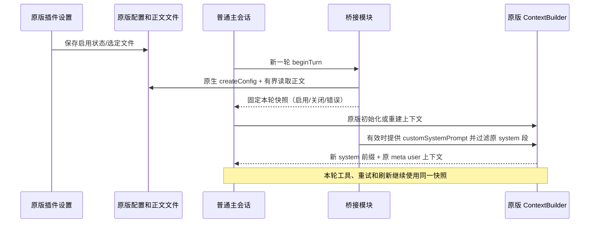

# zcode-unrestricted 设计

## 0.3.0 改名与仓库整理

产品和原生插件名称统一为 `zcode-unrestricted`，插件 ID 为
`zcode-unrestricted@inline`。新包使用新的插件目录、桥接目录和安装记录目录。
当前正式安装不由开发任务自动修改；用户检查后自行关闭 ZCode 并运行安装器。

安装器需要识别 0.2.0 的 `dsh-unrestricted` 安装记录和已校验的 Agent：
读取已校验原始备份生成新补丁；保留旧默认 prompt，并在新默认文件不存在时复制；
迁移用户级启用状态和 promptFile 选项，保留外部文件路径和无关配置。
旧工作区专属配置不自动扫描或改写，升级后在原版 UI 为新名称重新配置。
旧 prompt、备份和安装记录保留。旧已知 Hook 的未知修改拒绝覆盖。
安装失败恢复原 Agent、用户配置、桥接和本次安装记录，不把失败写成迁移完成。

仓库只保留此插件、可恢复安装器、验证代码、文档和必要运行时。
删除旧 CLI/上游源码、临时产物与旧交付包前核对 prompt 哈希；私人正文和用户草稿
原样保留并忽略，测试改用合成文本，不依赖或输出私人 prompt。
公共打包使用明确清单，默认不包含私人 prompt；保持首次安装的示例回退。

## 范围

交付标准 `.zcode-plugin/plugin.json` 插件、独立桥接模块和可回滚安装器。
用户继续使用已安装的桌面 ZCode，不编译/发布另一套 Agent，不走代理。
首版只支持 Windows 本地普通主会话；工作流、子代理、标题/摘要专用请求和
远程 Agent 不在覆盖范围内。Plan/Build 使用相同的主会话覆盖。

已核对版本：Desktop 3.14.4.7912；`resources/glm/zcode.cjs` 明文 bundle；
原始 SHA-256 `fad4c35c4c36ec210d8a06d3fa0e77de23c8545e2eb6ff90aea1eb38d1e6275f`。
这只是当前适配版本，不宣称未来版本支持。

## 唯一状态所有者

- 启用状态：原版 `plugins.enabledPlugins["zcode-unrestricted@inline"]`。
  安装默认关闭；用户在原版插件设置中开启。`plugins.enabled=false`、插件目录
  不再注册或 manifest 缺失也撤销覆盖。没有独立的第二个开关。
- 正文：插件持久化 data 目录中的 UTF-8 `system.md`；`userConfig.promptFile`
  可以指定另一文件。相对路径以会话初始工作区解析。
- 配置解析：每个普通 turn 调用当前 bundle 的原生 `createConfig`，复用其
  默认用户路径、父目录项目配置、environment 配置合并和校验。首版限定标准
  Desktop 用户配置路径；不承诺私有 embedding/自定义 bootstrap 路径。
- 本轮快照：桥接 WeakMap，以 runtime 对象为 key。每轮 admission 后、
  context 初始化前解析一次。builder 重建只使用此快照，不再次读正文。
- 原生基线：始终保留 runtime.config.systemPrompt，不写回配置。

## 补丁接线

1. bundle 顶部加载 `./zcode-unrestricted-native/bridge.cjs`；缺失或加载失败则使用无操作桥接。
2. 普通 turn 的 context_initialization 前异步解析本轮状态；compact/rewind 命令
   不开启新覆盖快照。已取消的输入不得继续重建上下文。
3. 原生 createContextBuilderFromSnapshot 的普通分支接收桥接后的配置。
4. ContextBuilder 排序和统计前过滤原 system 段，只保留覆盖正文；meta_user
   段仍保留。关闭时返回原配置/原 sections，走原版前缀替换流程。

不改变工具 schema、模型路由、鉴权、工具执行、历史正文或压缩摘要算法。
覆盖范围是主会话 ContextBuilder 的 system 前缀；其他专用模型调用不适配。

## 失败行为

正文 UTF-8 无效、为空、超过 256 KiB、缺失或读取失败：本轮撤销覆盖并用原生
基线。只记录错误码/修订号，不记录正文或配置对象。文件读取是异步、有界的。
退出/取消仍按原版 abort 传播。状态文件显示最近一次解析结果，不伪装成实时
UI 状态；尚未发送下一轮时标明 last-turn。

## 安装与恢复

- 用户关闭 ZCode 后运行安装器；脚本检查目标安装中的 ZCode 进程，不强制结束。
- 使用带 Node 的交付包，避免依赖旧项目、全局 Node 或终端 TUI。
- 先生成并语法校验候选 bundle，再备份原始 bytes 和写 receipt。
- 备份和 receipt 位于 `~/.zcode/cli/desktop-patches/zcode-unrestricted/<安装路径 hash>/`，
  独立于 app 安装资源和插件 data；更新器删除 glm 或原版 UI 清理插件时不会一起丢失。
- receipt 记录 Agent、桥接模块和 binding 三份 hash；状态检查全部匹配才显示 mounted。
- 只对适配 SHA 和唯一字符串锚点动刀；未知版本拒绝。重复安装幂等。
- 插件复制到用户持久目录，用 plugins.dirs 注册；初次默认关闭；已有正文不覆盖。
- 配置写入前比较原 bytes，冲突拒绝；只改本插件键，不整份重置配置。
- 安装失败恢复本次写入的配置、桥接、binding 和 receipt；回滚前再次核对内容，
  不覆盖失败期间发生的外部修改。已编辑正文和原始备份保留。
- 卸载只在当前 bundle 等于 receipt 的 patched hash 时恢复；如果 app 已升级且
  不带 Hook，则只清理注册，绝不把旧 bundle 恢复到新版。遇到其它带 Hook 的
  未知改动拒绝回滚。正文 data 保留。

## 验收

离线执行真实 bundle 中提取的 ContextBuilder、context factory 与 prefix refresh
函数；依赖用受控 fixtures 替换，不访问模型 API。验证完整 system 替换、关闭
恢复 SDK 基线、正文热更新、工具往返快照、项目配置优先级、38 KiB 原文、错误
回退、取消、子代理/工作流排除、meta user 和历史保留、统计一致。
安装测试在临时副本验证重复安装、配置/正文保留、失败回滚、升级后卸载和原始
bytes 完全恢复。正式安装目录仅只读检查；桌面实机测试单独报告。
